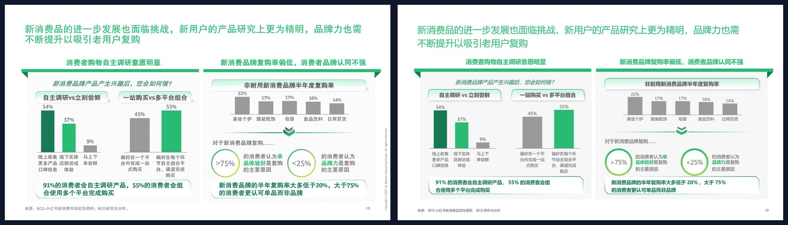
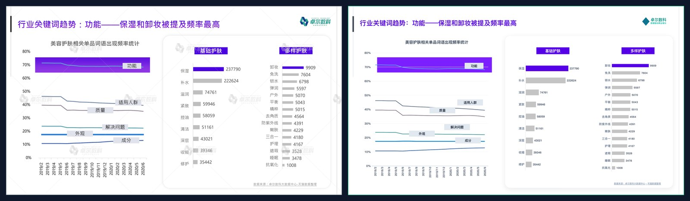
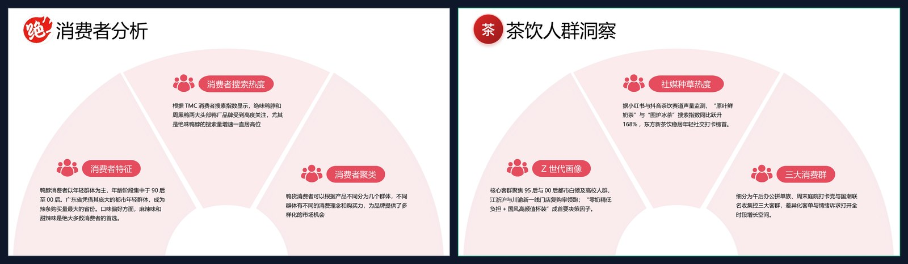
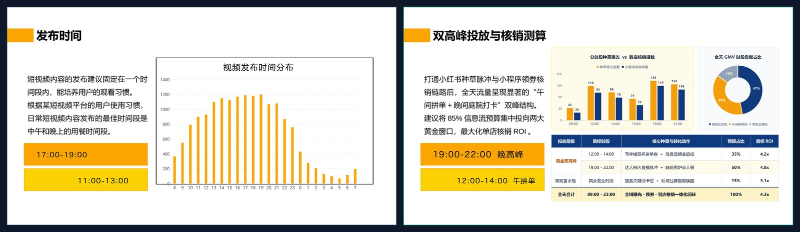

# Yuanmou PPT Skill & Zero-Dependency OOXML Engine (`yuanmou-ppt-skill` · `@yuanmou/pptx-kit`)

[](https://nodejs.org/)
[](#快速安装与自检)
[](#快速安装与自检)
[](./LICENSE)

> **Zero-dependency AI Agent PPT/PPTX Skill & Native OOXML Engine** for **Claude Code, OpenAI Codex, Cursor & Google Antigravity** — 1:1 visual template cloning, lossless `.pptx` deck surgery, native Excel-backed charts (`ppt/embeddings/*.xlsx`), proportional tables, and 5-gate atomic visual QA.
>
> **面向商业提案与咨询交付的「原生可编辑 PPT 引擎 & 母本级智能排版 Skill」**  
> **拒绝网页截图贴图 · 拒绝廉价 AI 卡片风 · 1:1 矢量复刻参考图 · `.pptx` 母本无损外科手术 · 图表双击弹真 Excel · 五道终检零溢出**  
> **零强制第三方 npm 依赖（Node.js `>=22.5` 纯自研 ESM，仓库仅 `1.1 MB`）** ｜ **许可：`PolyForm Noncommercial 1.0.0`（个人学习免费，严禁未授权商用）**

---

## 眼见为实：丢入「纯文字 Brief + 任意跨行业参考图」→ 一键重绘原生可编辑 `.pptx`


> 以下所有右侧成稿 **0 截图作弊**，全部由 `@yuanmou/pptx-kit` 原生生成标准 OOXML 矢量图形、透明渐变、原生表格 `<a:tbl>` 与内嵌真实 `.xlsx` 工作簿的 `<c:chart>`，PowerPoint / WPS 打开即可随意改字、换色、双击改 Excel 源数据！

### 1. 咨询级复杂矢量 1:1 复刻（仅 `18 KB` 纯矢量：3D 折角丝带 + 双向透明渐变切角框 + 斜纹底板）


### 2. 多系列真图表 1:1 复刻（仅 `25.6 KB`：6 系列折线图 + 双栏 Top-Down 横向条形图，均带独立内嵌 `.xlsx`）


### 3. 既有 `.pptx` 原版母本无损外科手术（保留巨型渐变三扇环 + 跨 `<a:r>` 拆词保样式换血 + 自动瘦身 97%）


### 4. 混合外科手术 Hybrid Mode（保留原版母版左栏骨架 + 原位注入内嵌 `.xlsx` 柱形/环形双图与跨行合并表）


---

## 核心五大军火库（20 项自研能力）

1. **双模矢量与流式排版内核（武器 `01–06`）**：`96DPI px <-> EMU` 坐标、`compose(row/col/grid/layers/box)` 12 列网格解算器、Tailwind 视觉 Token 与多色标 Alpha 透明渐变、跨平台透明渐变描边折线生成器、单 `<p:sp>` 中英双绑富文本与原生悬挂列表、`customPaths`/SVG 贝塞尔路径、`<a:srcRect>` 零拉伸居中裁切。
2. **既有 `.pptx` 母本无损外科手术五件套（武器 `07–11`）**：`inspectTemplateDeck` 拆包透视 → `validateTemplatePlan` 作战图预检 → `prepareStarterDeck` 无损克隆抽页（内置 OPC 可达性垃圾回收，35MB 母包抽 2 页自动瘦身至 1MB）→ `Presentation.load().resolve()` 跨 `<a:r>` 拆词改字与异形蒙版原位换图 → `auditTemplateFidelity` 反作弊终检。
3. **原生数据实证引擎（武器 `12–15`）**：支持 `fixed()` / `fr()` 混合比例列宽与跨行跨列合并的原生 `<a:tbl>`；零依赖生成内嵌真实 `ppt/embeddings/*.xlsx` 工作簿的柱状图、横向条形图（自动 `maxMin` 榜首置顶 + `pointFills` 单条高亮）、折线图、面积图、饼图与环形图，5 大文本部位强制绑定中文字体 `<a:ea>`。
4. **五道原子终检门闸 `finalizeDeck`（武器 `16–18`）**：导出前自动校验 OOXML 法定子元素粒子序、越界与文本框碰撞（AABB）、本机字体扫描、中英字形前进宽度溢出、图表 `.xlsx` 缓存一致性及原生表格合计行算术核对，通过后原子发布并隔离留存 `.validation.json` 回执。
5. **中文商业去 AI 腔铁律 & 可插拔数据源（武器 `19–20` + `SlideSourceProvider` SPI）**：内置封杀“赋能 / 抓手 / 生态闭环 / 不是…而是…”词典；支持 `local`（免费离线）/ `zsxq`（V1 知识星球免费+VIP 阶梯）/ `yuanmou-cloud`（V2 自有 API + Cloudflare R2 预留扩展位）无缝切换。

---

## 四阶使用指南（无模板库也能丝滑用，接入星球解锁全库弹药）

| 阶梯 | 适合人群 | 解锁能力与启动方式 |
| :--- | :--- | :--- |
| **L0 开源离线版**<br>(`local` · 0 门槛) | 所有开源个人学习者 | **无需注册与联网**！离线直接调用 12 套咨询级原生骨架、1:1 复刻你自己的参考截图、或无损改版你自己的 `.pptx` 模板 |
| **L1 免费体验营**<br>(`zsxq` · 0 元免审) | 想体验云端真母本与报告联动 | 知识星球搜索 **`77391343`** 0 元免审加入 **「广告营销及各行业报告资料分享」**（含 500+ 份公开营销报告与精选通用体验 `.pptx`），运行 `provider_cli.mjs connect` 微信扫码即通 |
| **L2 双星球 VIP**<br>(`zsxq` · 全库弹药) | 策划总监、咨询顾问、品牌运营 | 加入两大日更主力总库（**无需改任何电脑配置，付费入群即自动升级解锁**）：<br>• **渊眸·数据行业报告库（星球号 `43773104`）**：2026 尼尔森/BCG/小红书等 8 大赛道深度报告（`1001–4999`）<br>• **渊眸·品牌策划方案库（星球号 `37656012`）**：4A 与一线品牌高清可编辑 `.pptx` 原厂全案与单页索引（`5001–9999`） |
| **L3 企业商用 / 定制**<br>(找星主 Ann) | 品牌主理人、企业市场部、Agency | 采购企业商业使用授权，或直接委托 **渊眸策略** 真人团队承接 **方案撰写定制、账号代运营、品牌直播与全域种草**（价格亲民，知识星球内私信 **星主 Ann**） |

---

## 快速安装与自检

环境要求：**Node.js `>= 22.5`**（原生内置 `node:sqlite` 与 `node:zlib`，**零 `npm install` 第三方依赖**）。如需本地无头渲染高清 PNG 对比图，建议安装 LibreOffice 与 Poppler。

```bash
# 0. 克隆仓库（仅 1.1 MB，零 npm install）
git clone https://github.com/YuanMouJun/yuanmou-ppt-skill.git
cd yuanmou-ppt-skill

# 1. 一键挂载 Skill 至 Claude Code / Codex / Cursor / Antigravity
node scripts/install.mjs --target all

# 2. (可选) 一键拉起知识星球官方 OAuth 扫码授权，连接免费体验星球(77391343)或 VIP 总库
node skills/yuanmou-ppt/scripts/provider_cli.mjs connect

# 3. 查看当前激活的数据源模式
node skills/yuanmou-ppt/scripts/provider_cli.mjs status

# 4. 运行 5 道终检门闸与可插拔 Provider 完整自测
npm run test:m3
```

---

## 非商业开源许可与法律声明

本仓库全部源码、脚本与文档采用 **[PolyForm Noncommercial License 1.0.0](./LICENSE)** 授权：

- **允许**：个人出于非商业目的（个人学习、学术研究、个人技术探索）免费使用与修改。
- **严禁（未经「渊眸策略」书面商业授权）**：任何企业/MCN/咨询/广告代理商用于内部商业汇报或对外客户商单交付；集成至任何付费软件、SaaS、API 或小程序；用于付费课程、训练营或代安装变现。详见 [LICENSE-COMMERCIAL.md](./LICENSE-COMMERCIAL.md)。
