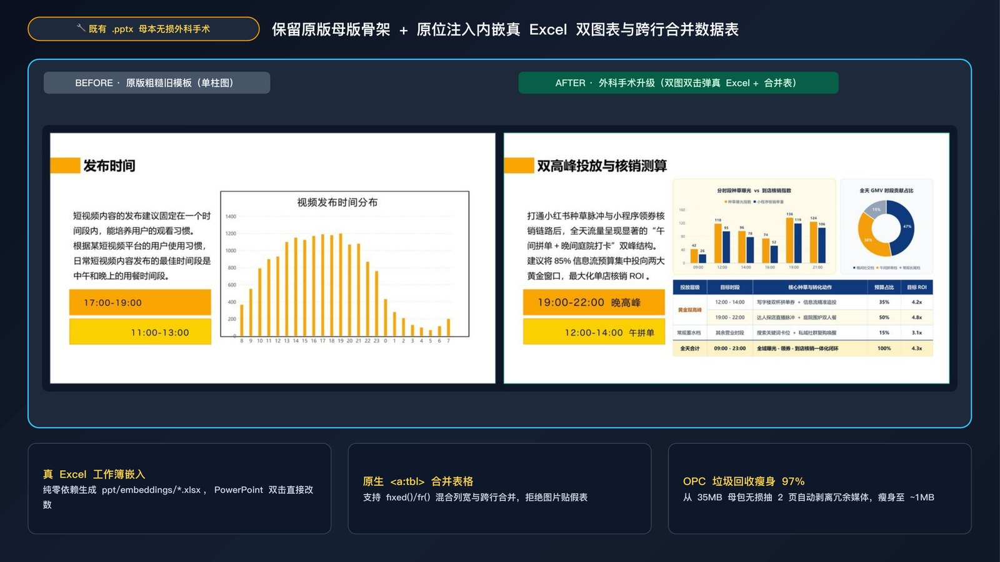
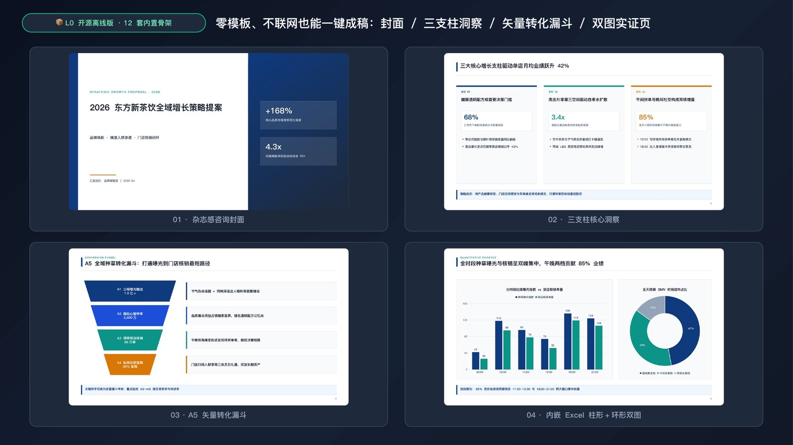
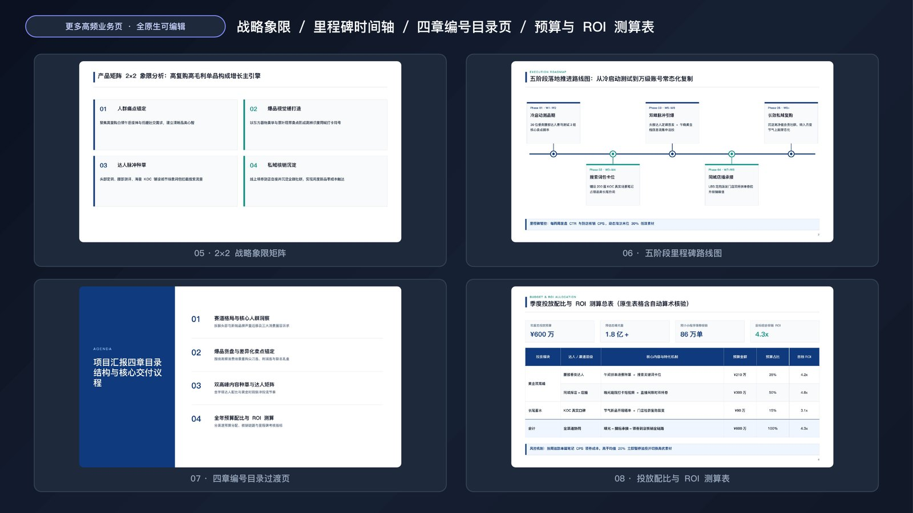

# yuanmou-ppt-skill (`@yuanmou/pptx-kit`)

[](https://nodejs.org/)
[](#快速开始)
[](#快速开始)
[](./LICENSE)

> **Zero-dependency native OOXML PowerPoint (`.pptx`) engine & AI Agent Skill** for **Claude Code, OpenAI Codex, Cursor, and Antigravity** — built for people who need real editable slides (native vector shapes, embedded `.xlsx` charts, lossless `.pptx` template editing) rather than static images or broken HTML exports.
>
> **一个零第三方依赖的原生可编辑 `.pptx` 引擎与 AI Agent Skill**（支持 Claude Code / Codex / Cursor / Antigravity），专注解决真实提案与汇报场景里「AI 做出来的 PPT 没法二次修改、改旧模板容易走样、图表不能改数据」的问题。

---

## 为什么做这个 Skill？

如果你之前用过市面上的 AI PPT 工具或开源 PPT Skill，大概率遇到过这几个实际困扰：

1. **生图/截图类 PPT 看着好看，但交付不了**：一旦老板或客户说“把第三段字改一下、柱状图里的数据换成 Q3 的”，整张死图只能推倒重做。
2. **HTML / 网页转 PPT 导出容易散架**：浏览器里预览很炫，转成 `.pptx` 放进 PowerPoint / WPS 打开后，字体、表格、对齐和图表经常错位。
3. **传统 `python-pptx` 或重依赖方案上手门槛高、改旧模板易坏**：光配 Python 虚拟环境和 C 扩展就容易报错；而且直接改既有 `.pptx` 模板时，很容易破坏原版的母版渐变、圆角图片蒙版，或者漏掉一堆没删干净的冗余素材导致文件动辄几十 MB。
4. **中文商业排版容易“AI 腔”且细节粗糙**：常见默认套一堆圆角卡片、字体偏细偏小、或者文字溢出文本框没人兜底。

`yuanmou-ppt-skill` 是我们在大量真实品牌策划与咨询汇报交付中逐步沉淀下来的方案：底层用纯 Node.js（`>= 22.5`）直接按 ECMA-376 标准读写原生 OOXML 与嵌入式 `.xlsx`，**没有任何第三方 npm 依赖，仓库总计约 1.1 MB**，既可以 0 模板离线成稿，也可以对照参考截图 1:1 重绘，或者直接对现有 `.pptx` 模板做无损原位改版。

---

## 与常见 PPT Skill / 排版方案的客观对比

如果你正在对比不同的 PPT Skill，下面这张表可以帮你快速判断是否适合自己的场景：

| 对比维度 | 生图 / 截图流 PPT Skill | HTML / 网页转 PPT Skill | 传统 `python-pptx` / 重依赖方案 | **`yuanmou-ppt-skill` (`@yuanmou/pptx-kit`)** |
| :--- | :--- | :--- | :--- | :--- |
| **生成物是否原生可编辑** | ❌ 整页死图，文字和图表不可改 | ⚠️ 导出 `.pptx` 后常见排版错位 | ✅ 原生可编辑 | ✅ **100% 原生 OOXML（形状/文字/表格/图表全可改）** |
| **图表能否双击改 Excel** | ❌ 静态图片 | ❌ 多为静态图或前端 Canvas | ⚠️ 配置繁琐，中文字体常乱码 | ✅ **零依赖内嵌真实 `ppt/embeddings/*.xlsx`**，双击直接改数 |
| **既有 `.pptx` 模板无损改版** | ❌ 不支持 | ❌ 不支持 | ⚠️ 容易破坏原母版与异形图片蒙版 | ✅ **内置五步原位改版流**（保蒙版裁切 + 跨 `<a:r>` 改字 + 自动清理未用媒体） |
| **对照参考图 1:1 复刻** | ⚠️ 只能做近似风格图 | ⚠️ 依赖前端样式还原 | ⚠️ 缺少渐变透明度/圆角梯形原语 | ✅ **支持 `<a:alpha>` 透明渐变、圆角多边形与 `inspect-ref`/`diff` 叠图校准** |
| **环境与依赖体积** | 依赖生图 API | 常需无头浏览器 | 常需 50~400 MB Python/C 依赖 | ✅ **0 npm 依赖（仅需 Node.js >=22.5），克隆仅 ~1 MB** |
| **质量与排版兜底** | 依赖人工肉眼 | 依赖人工肉眼 | 多数无内置终检 | ✅ **内置 `finalizeDeck` 五项自动检查**（包结构/碰撞/字体/溢出/算术） |

### 诚实说明：它目前的能力边界
为了避免不切实际的预期，我们也把目前的边界说明白：
- **生成与改版 `.pptx` 本身完全零依赖**；但如果希望 AI 在交付前自动把 `.pptx` 渲染成高清图片做视觉自检，本机需要安装 **LibreOffice (`soffice`) + `pdftoppm`**（未安装时依然可以正常生成 `.pptx`，只是跳过视觉渲染自检）。
- **目前聚焦咨询/策划高频 95% 的版式与图表类型**（柱状/条形/折线/面积/饼/环图、原生合并表、矢量路径、母版换字换图）；极冷门的 3D 图表、双轴组合图或非常规软件生成的畸形旧版 PPTX 仍在持续兼容中。

---

## 实际案例展示

以下展示页均由本引擎原生生成标准 `.pptx`（非截图拼贴），在 PowerPoint / WPS / Keynote 中打开后，所有图形、渐变、文字、表格与图表数据均可直接编辑。

### 案例 1：纯文字资料 + 跨行业参考图 → 1:1 换血重绘为可编辑 `.pptx`
把一段杂乱的纯文字业务 Brief，配合一张完全不同行业的参考截图交给 Agent，保留原版式的视觉层级、半透明玻璃椭圆与色彩结构，自动替换成目标行业的内容、数据与实拍图。


### 案例 2：既有 `.pptx` 旧母本原位升级（保留骨架 + 注入真 Excel 双图与合并表）
面对已有的老旧 `.pptx` 模板，不推倒重画，保留原版左栏结构与配色，在右侧原位注入内嵌真实 `.xlsx` 工作簿的柱形图、环形图与跨行合并原生表格，并自动剥离未选页冗余媒体。



### 案例 3：无模板离线成稿 —— 内置咨询级原生骨架（1~4：封面 / 洞察 / 漏斗 / 双图）
即使手里没有任何参考图或母本，离线模式也可以直接调用内置的 12 套咨询骨架快速出稿。



### 案例 4：更多高频业务页（5~8：2×2 战略象限 / 五阶段路线图 / 目录过渡页 / 预算 ROI 测算表）
覆盖战略分析、项目排期、竞品对比与预算测算等日常高频页，表格均为原生 `<a:tbl>` 且内置合计行算术核对。



---

## 核心工作流与省 Token 机制

为了让 AI 在不同难度的页面上兼顾“还原度”与“速度/成本”，[SKILL.md](./skills/yuanmou-ppt/SKILL.md) 内置了按难度分级的执行策略：

- **L1 · 既有 `.pptx` 母本改版（最省 Token、还原度最高）**：直接解析原 `.pptx` 元素锚点，原位改字、保蒙版换图、注入原生图表，无需重绘结构，最后做 1 次交付终检即可。
- **L2 · 常规截图 / 离线骨架页**：直接单步生成 `.pptx` + 1 次全页并排渲染核对，不做多余轮次。
- **L3 · 高难异形截图 1:1 复刻**：仅在遇到半透明叠层椭圆、弧边锥体、圆角倒梯形、复杂流程图时，才按需调用内置 `deck_cli.mjs inspect-ref`（2× 局部采色测透）与 `deck_cli.mjs diff`（50% 半透明叠图校准），先定壳子再灌图文。

---

## 快速开始

环境要求：**Node.js `>= 22.5`**（直接利用原生内置的 `node:sqlite` 与 `node:zlib`，无需 `npm install`）。

```bash
# 1. 克隆仓库（约 1.1 MB）
git clone https://github.com/YuanMouJun/yuanmou-ppt-skill.git
cd yuanmou-ppt-skill

# 2. 一键安装 Skill 到 Claude Code / Codex / Cursor / Antigravity
node scripts/install.mjs --target all

# 3. 运行内置自检测试（验证引擎、五项终检门闸与数据源接口）
npm run test:m3
```

---

## 离线使用与可选云端资料库说明

本开源包默认以 **`local` 离线模式** 开箱即用，不强制注册或联网；如果你在日常策划中需要直接调用现成的 `.pptx` 母本或最新行业报告数据，引擎也通过可插拔的 `SlideSourceProvider` 接口支持按需接入外部资料库：

| 使用方式 | 适合人群 | 说明 |
| :--- | :--- | :--- |
| **L0 · 开源离线版（默认）** | 所有个人学习与本地排版用户 | 无需注册与联网，直接使用内置 12 套咨询骨架、复刻自己的参考截图，或原位改版自己的 `.pptx` 文件。 |
| **L1 · 免费公开体验星球** | 想体验“云端报告 + `.pptx` 母本”联动 | 知识星球搜索 **`77391343`**（0 元免审加入「广告营销及各行业报告资料分享」，含 500+ 份公开行业报告与精选通用体验 `.pptx`），运行 `node skills/yuanmou-ppt/scripts/provider_cli.mjs connect` 扫码即可连接。 |
| **L2 · 日更主力资料库（付费）** | 策划、咨询与品牌运营从业者 | 如需规模化 `.pptx` 原厂母本与 2026 各赛道深度报告，可按需加入 **渊眸·数据行业报告库（`43773104`）** 与 **渊眸·品牌策划方案库（`37656012`）**，入群后无需改本机配置即可直接检索调用。 |
| **L3 · 企业商用授权 / 人工定制** | 企业市场部、品牌方、Agency | 如用于企业商业交付或需要团队人工承接方案撰写、账号运营与全域种草，可在知识星球内私信 **星主 Ann** 咨询。 |

---

## 目录结构

```text
yuanmou-ppt-skill/
├── packages/pptx-kit/          # 零依赖原生 OOXML 引擎（图形/表格/内嵌.xlsx图表/母本改版/五项终检/SPI）
├── skills/yuanmou-ppt/         # Agent Skill 定义（SKILL.md + 结构还原规范 + provider_cli / deck_cli）
├── scripts/install.mjs         # Claude Code / Codex / Cursor / Antigravity 一键安装脚本
├── examples/                   # 自包含验证与示例脚本
├── docs/showcase/              # README 实战展示图
├── LICENSE                     # PolyForm Noncommercial License 1.0.0（非商业个人学习免费）
└── LICENSE-COMMERCIAL.md       # 企业商业使用授权说明
```

## 许可协议

本项目采用 **[PolyForm Noncommercial License 1.0.0](./LICENSE)**：个人非商业学习、技术研究与内部自测完全免费；任何企业办公汇报交付、商业外包/商单制作、付费课程或 SaaS 集成，请参阅 [LICENSE-COMMERCIAL.md](./LICENSE-COMMERCIAL.md) 获取商业授权。
