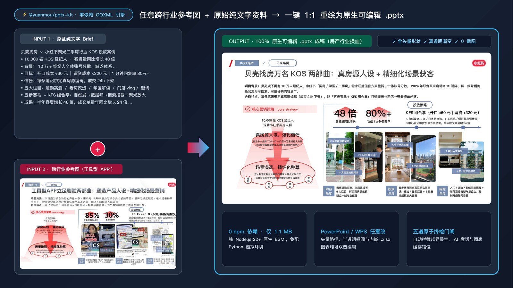
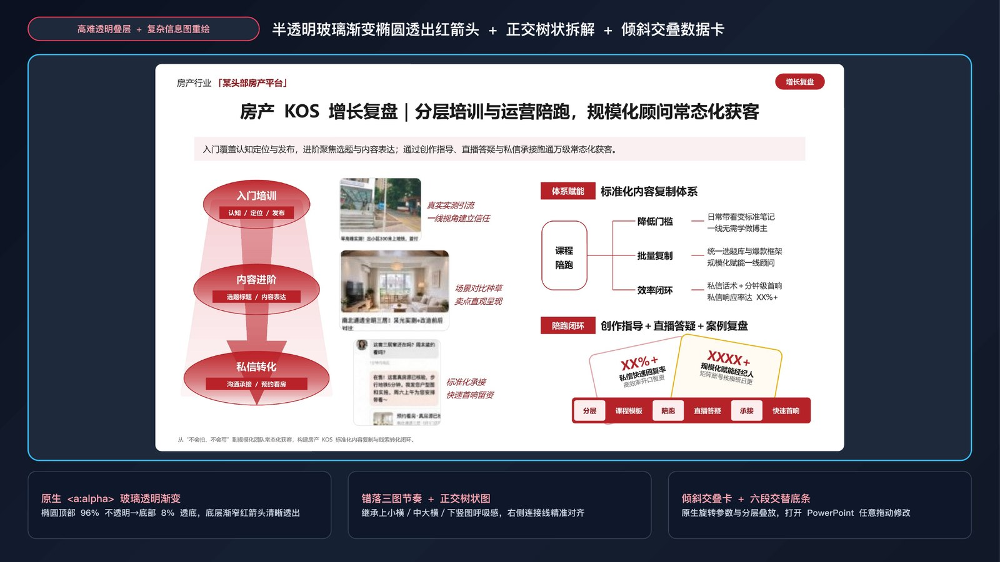

# yuanmou-ppt-skill (`@yuanmou/pptx-kit`)

[](https://nodejs.org/)
[](#快速开始)
[](#快速开始)
[](./LICENSE)

> **Zero-dependency native OOXML PowerPoint (`.pptx`) engine & AI Agent Skill** for **Claude Code, OpenAI Codex, Cursor, and Antigravity** — built for people who need real editable slides (native vector shapes, embedded `.xlsx` charts, lossless `.pptx` template editing) rather than static images or broken HTML exports.
>
> **一个零第三方依赖的原生可编辑 `.pptx` 引擎与 AI Agent Skill**（支持 Claude Code / Codex / Cursor / Antigravity），专注解决真实提案与汇报场景里「AI 做出来的 PPT 没法二次修改、改旧模板容易走样、图表不能改数据」的问题。

---

## 为什么做这个 Skill？

如果你之前用过市面上的 AI PPT 工具或开源 PPT Skill，大概率遇到过这几个实际困扰：

1. **生图/截图类 PPT 看着好看，但交付不了**：一旦老板或客户说“把第三段字改一下、柱状图里的数据换成 Q3 的”，整张死图只能推倒重做。
2. **HTML / 网页转 PPT 导出容易散架**：浏览器里预览很炫，转成 `.pptx` 放进 PowerPoint / WPS 打开后，字体、表格、对齐和图表经常错位。
3. **传统 `python-pptx` 或重依赖方案上手门槛高、改旧模板易坏**：光配 Python 虚拟环境和 C 扩展就容易报错；而且直接改既有 `.pptx` 模板时，很容易破坏原版的母版渐变、圆角图片蒙版，或者漏掉一堆没删干净的冗余素材导致文件动辄几十 MB。
4. **中文商业排版容易“AI 腔”且细节粗糙**：常见默认套一堆圆角卡片、字体偏细偏小、或者文字溢出文本框没人兜底。

`yuanmou-ppt-skill` 是我们在大量真实品牌策划与咨询汇报交付中逐步沉淀下来的方案：底层用纯 Node.js（`>= 22.5`）直接按 ECMA-376 标准读写原生 OOXML 与嵌入式 `.xlsx`，**没有任何第三方 npm 依赖，仓库总计约 1.1 MB**，既可以 0 模板离线成稿，也可以对照参考截图 1:1 重绘，或者直接对现有 `.pptx` 模板做无损原位改版。

---

## 与常见 PPT Skill / 排版方案的客观对比

如果你正在对比不同的 PPT Skill，下面这张表可以帮你快速判断是否适合自己的场景：

| 对比维度 | 生图 / 截图流 PPT Skill | HTML / 网页转 PPT Skill | 传统 `python-pptx` / 重依赖方案 | **`yuanmou-ppt-skill` (`@yuanmou/pptx-kit`)** |
| :--- | :--- | :--- | :--- | :--- |
| **生成物是否原生可编辑** | ❌ 整页死图，文字和图表不可改 | ⚠️ 导出 `.pptx` 后常见排版错位 | ✅ 原生可编辑 | ✅ **100% 原生 OOXML（形状/文字/表格/图表全可改）** |
| **图表能否双击改 Excel** | ❌ 静态图片 | ❌ 多为静态图或前端 Canvas | ⚠️ 配置繁琐，中文字体常乱码 | ✅ **零依赖内嵌真实 `ppt/embeddings/*.xlsx`**，双击直接改数 |
| **既有 `.pptx` 模板无损改版** | ❌ 不支持 | ❌ 不支持 | ⚠️ 容易破坏原母版与异形图片蒙版 | ✅ **内置五步原位改版流**（保蒙版裁切 + 跨 `<a:r>` 改字 + 自动清理未用媒体） |
| **对照参考图 1:1 复刻** | ⚠️ 只能做近似风格图 | ⚠️ 依赖前端样式还原 | ⚠️ 缺少渐变透明度/圆角梯形原语 | ✅ **支持 `<a:alpha>` 透明渐变、圆角多边形与 `inspect-ref`/`diff` 叠图校准** |
| **环境与依赖体积** | 依赖生图 API | 常需无头浏览器 | 常需 50~400 MB Python/C 依赖 | ✅ **0 npm 依赖（仅需 Node.js >=22.5），克隆仅 ~1 MB** |
| **质量与排版兜底** | 依赖人工肉眼 | 依赖人工肉眼 | 多数无内置终检 | ✅ **内置 `finalizeDeck` 五项自动检查**（包结构/碰撞/字体/溢出/算术） |

### 诚实说明：它目前的能力边界
为了避免不切实际的预期，我们也把目前的边界说明白：
- **生成与改版 `.pptx` 本身完全零依赖**；但如果希望 AI 在交付前自动把 `.pptx` 渲染成高清图片做视觉自检，本机需要安装 **LibreOffice (`soffice`) + `pdftoppm`**（未安装时依然可以正常生成 `.pptx`，只是跳过视觉渲染自检）。
- **目前聚焦咨询/策划高频 95% 的版式与图表类型**（柱状/条形/折线/面积/饼/环图、原生合并表、矢量路径、母版换字换图）；极冷门的 3D 图表、双轴组合图或非常规软件生成的畸形旧版 PPTX 仍在持续兼容中。

---

## 实际案例展示

以下展示页均由本引擎原生生成标准 `.pptx`（非截图拼贴），在 PowerPoint / WPS / Keynote 中打开后，所有图形、渐变、文字、表格与图表数据均可直接编辑。

### 案例 1：纯文字资料 + 跨行业参考图 → 1:1 换血重绘为可编辑 `.pptx`
把一段杂乱的纯文字业务 Brief，配合一张完全不同行业的参考截图交给 Agent，保留原版式的视觉层级、半透明玻璃椭圆与色彩结构，自动替换成目标行业的内容、数据与实拍图。



### 案例 2：既有 `.pptx` 旧母本原位升级（保留骨架 + 注入真 Excel 双图与合并表）
面对已有的老旧 `.pptx` 模板，不推倒重画，保留原版左栏结构与配色，在右侧原位注入内嵌真实 `.xlsx` 工作簿的柱形图、环形图与跨行合并原生表格，并自动剥离未选页冗余媒体。


### 案例 3：高难矢量图示重绘 —— 圆角倒梯形三层漏斗 + 双分支矢量闭环流程图
针对传统工具最容易画糙的漏斗与流程图页，使用内置二次贝塞尔圆角路径与原生矢量图标重绘，保留半压标签、炭灰侧栏与精确字重层级，全页可双击编辑。


### 案例 4：高难透明叠层重绘 —— 半透明玻璃渐变椭圆透出红箭头 + 正交树状图 + 倾斜双卡
通过原生 `<a:alpha>` 渐变透明度通道还原“顶部不透明 → 底部透出底层渐窄红箭头”的玻璃叠层质感，右侧结合正交连接树、倾斜交叠数据卡与六段交替总结条。



---

## 核心工作流与省 Token 机制

为了让 AI 在不同难度的页面上兼顾“还原度”与“速度/成本”，[SKILL.md](./skills/yuanmou-ppt/SKILL.md) 内置了按难度分级的执行策略：

- **L1 · 既有 `.pptx` 母本改版（最省 Token、还原度最高）**：直接解析原 `.pptx` 元素锚点，原位改字、保蒙版换图、注入原生图表，无需重绘结构，最后做 1 次交付终检即可。
- **L2 · 常规截图 / 离线骨架页**：直接单步生成 `.pptx` + 1 次全页并排渲染核对，不做多余轮次。
- **L3 · 高难异形截图 1:1 复刻**：仅在遇到半透明叠层椭圆、弧边锥体、圆角倒梯形、复杂流程图时，才按需调用内置 `deck_cli.mjs inspect-ref`（2× 局部采色测透）与 `deck_cli.mjs diff`（50% 半透明叠图校准），先定壳子再灌图文。

---

## 快速开始

环境要求：**Node.js `>= 22.5`**（直接利用原生内置的 `node:sqlite` 与 `node:zlib`，无需 `npm install`）。

```bash
# 方式一：通过 skills.sh 一键安装（推荐，支持 Claude Code / Codex / Cursor / Gemini CLI 等）
npx skills add YuanMouJun/yuanmou-ppt-skill

# 方式二：克隆仓库本地安装（约 1.1 MB，0 第三方 npm 依赖）
git clone https://github.com/YuanMouJun/yuanmou-ppt-skill.git
cd yuanmou-ppt-skill
node scripts/install.mjs --target all

# 3. 运行内置自检测试（验证引擎、五项终检门闸与数据源接口）
npm run test:m3
```

---

## 两种使用方式：开源离线本地模式 vs 飞书云盘版式库

两者的核心区别很简单：**「自己找图复刻」还是「直接用现成的商业排版库」**——代码引擎能力完全一致，按需选择即可：

| 使用方式 | 核心区别 | 具体能做什么 |
| :--- | :--- | :--- |
| **L0 · 开源离线本地模式（默认）** | **自带参考图 / 自带 `.pptx`**（无需登录与联网） | 你在**小红书、行业报告、PDF 或公开案例里看到任何一张好看的排版截图**，直接丢给它，就能 1:1 复刻成可编辑原生 `.pptx` 并原位换成你自己的内容；手里有现成 `.pptx` 模板也可直接无损改版（支持 `YUANMOU_LOCAL_DIR` 挂载自己的本地图库）。 |
| **L1 · 飞书云盘免费体验仓** | **自带精选商业排版库**（免费体验） | 不想自己到处找参考图时，加入渊眸飞书免费体验仓并运行 `node skills/yuanmou-ppt/scripts/provider_cli.mjs connect --provider feishu` 扫码授权，即可按槽位与图示家族秒搜精选无水印商业版式，按需拉取高清原图直接复刻。 |
| **L2 · 飞书云盘 VIP 全量仓（付费）** | **自带 29,000+ 页全量商业排版库** | 覆盖 **29,000+ 页**持续日更的无水印高清商业版式原图（含 12 类结构化图示家族与精细槽位指纹索引），本地毫秒级查库、按需拉取单张无损 PNG 并永久缓存，省去满网找参考图与构图试错的时间。 |
| **L3 · 行业报告库与团队定制** | **数据报告 + 真人定制** | 代码本身 Apache-2.0 免费商用；如需独立的 2026 各赛道行业报告库 / 完整 `.pptx` 策划方案库，或由渊眸团队真人承接方案撰写定制与品牌代运营，可联系 **渊眸策略**。 |

---

## 目录结构

```text
yuanmou-ppt-skill/
├── packages/pptx-kit/          # 零依赖原生 OOXML 引擎（图形/表格/内嵌.xlsx图表/母本改版/五项终检/SPI）
├── skills/yuanmou-ppt/         # Agent Skill 定义（SKILL.md + 结构还原规范 + provider_cli / deck_cli）
├── scripts/install.mjs         # Claude Code / Codex / Cursor / Antigravity 一键安装脚本
├── examples/                   # 自包含验证与示例脚本
├── docs/showcase/              # README 实战展示图
├── LICENSE                     # Apache License 2.0（允许个人与企业商业项目免费使用）
└── NOTICE                      # 渊眸策略版权与署名声明
```

## 许可协议

本项目代码引擎与 Skill 定义采用标准 OSI 认证的 **[Apache License 2.0](./LICENSE)**：**完全允许个人学习、企业办公汇报、商业项目与二次开发免费使用**（二次分发须按 Apache-2.0 保留 [NOTICE](./NOTICE) 中的「渊眸策略」版权署名）。

> 注：外部知识星球内托管的行业报告与 `.pptx` 原厂母本属于星球会员专享资料，不适用代码开源协议，仅供会员参考使用，严禁转售或公开二次分发。
