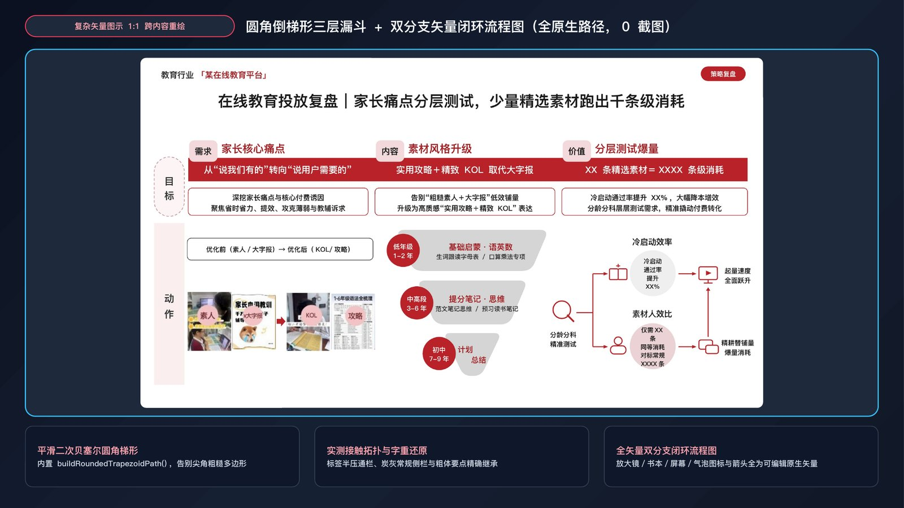

# yuanmou-ppt-skill (`@yuanmou/pptx-kit`)

[](https://nodejs.org/)
[](#快速开始)
[](#快速开始)
[](./LICENSE)

> **All-in-One AI PPT Generator & Image / Screenshot / PDF to Editable PPTX Skill** for **WorkBuddy, Trae, Qoder, CodeBuddy, OpenClaw, Claude Code, OpenAI Codex, Cursor, and Antigravity** — go from a **one-sentence topic** to a complete consulting-grade editable presentation backed by **16,000+ real commercial layouts**, convert any complex screenshot or PDF 1:1 into real editable PowerPoint (native vector paths, `<a:alpha>` translucent glass layers, embedded `.xlsx` Excel-backed charts), or perform lossless `.pptx` template editing with **11 automated OOXML & visual QA gates**.
>
> **一句话从零策划整套商业 PPT / 图片转可编辑 PPT / 截图转 PPT / PDF 转可编辑 PPT · 零第三方依赖原生 `.pptx` 引擎与全端 AI Agent Skill**（全覆盖国内主流 **WorkBuddy / Trae / Qoder / CodeBuddy / OpenClaw（龙虾）/ Kimi / Qwen Code** 与海外 **Claude Code / Codex / Cursor / Antigravity**）。无论是**只给一句话主题从零策划大纲、去 AI 腔文案、匹配 1.6W+ 真实商业版式库出整套视觉大片**，还是**把任意复杂截图/PDF 1:1 矢量复刻为可编辑 PowerPoint**、**对老旧 `.pptx` 无损换字换图与注入真 Excel 图表**，全链路一条龙交付。

---

## 快速开始

### 必装环境依赖（强制门禁）
为确保每一页 PPT 在交付前都经过真机渲染与视觉对齐核验（拒绝“盲画交付”），安装与运行前需具备以下环境（**零第三方 npm 依赖**）：
- **Node.js `>= 22.5`**（内置 `node:sqlite` 与 `node:zlib`，无需 `npm install`）
- **LibreOffice (`soffice`) + Poppler (`pdftoppm`)**（用于真机渲染 PNG 与视觉自检）：
  ```bash
  # macOS
  brew install --cask libreoffice && brew install poppler
  # Ubuntu / Debian
  sudo apt update && sudo apt install -y libreoffice poppler-utils
  # Windows
  winget install TheDocumentFoundation.LibreOffice  # 并将 poppler 加入 PATH
  ```

### 安装与自检

```bash
# 方式一（WorkBuddy / 非命令行办公用户推荐）：直接下载自包含 .zip 拖入客户端导入
# 从 Releases 下载 `yuanmou-ppt-skill.zip`（https://github.com/YuanMouJun/yuanmou-ppt-skill/releases/latest）
# 打开腾讯 WorkBuddy -> 左侧「专家·技能·连接器」->「上传技能」-> 拖入 zip 即用

# 方式二：通过 skills.sh 一键安装（自动识别 WorkBuddy / OpenClaw / Trae / Qoder / CodeBuddy / Claude Code / Codex / Cursor）
npx skills add YuanMouJun/yuanmou-ppt-skill

# 方式三：克隆仓库本地安装（约 1.1 MB，0 第三方 npm 依赖；自动执行必装环境门禁检查）
git clone https://github.com/YuanMouJun/yuanmou-ppt-skill.git
cd yuanmou-ppt-skill
node scripts/install.mjs --target all
# 或按需指定端：--target workbuddy,trae,qoder,codebuddy,openclaw,claude,codex,cursor,antigravity,agents

# 3. 运行环境与引擎自检
node skills/yuanmou-ppt/scripts/deck_cli.mjs check-env
npm run test:m3
```

---

## 两种使用方式：图片转可编辑 PPT（开箱即用） vs 飞书云盘 10W+ 版式库

装完即可零门槛开箱用；如果想要更全面、更高级的全行业商业版式，可按需接入飞书云盘版式库：

| 对比维度 | **免费版 · 全能 PPT 制作（开箱即用）** | **进阶 VIP · 飞书云盘 10W+ 高质量版式库** |
| :--- | :--- | :--- |
| **上手门槛** | ✅ **0 登录、0 配置、开箱即用**（安装完第一句话就能跑） | 飞书扫码授权 1 次（30 秒），后续自动免登续期 |
| **一句话从零策划整套 PPT** | ✅ **支持从零创意策划**：只给一句话主题 → 咨询级大纲与去 AI 腔文案策划 → 1.6W+ 商业版式库同构选版 → 视觉大片级原生可编辑整套 `.pptx` | ✅ 完全包含，且可从 **10W+ 顶级商业视觉版式** 中挑版，审美上限更高 |
| **图片 / 截图 / PDF 转 PPT** | ✅ 随手丢入小红书、行业报告、PDF 任意复杂排版（含多层遮罩、半透明玻璃叠层、圆角梯形），经 50% X-Ray 叠图与自动热点 2× 精检 1:1 还原为可编辑 `.pptx` | ✅ 完全包含（同一套 11 门禁矢量引擎） |
| **既有 `.pptx` 无损改版** | ✅ 支持对自己的 `.pptx` 模板原位换字、保蒙版换图、注入真 Excel 图表 | ✅ 完全包含 |
| **内置现成商业版式库** | ✅ **开箱免登录自带 1.6W+ 页高质免费体验库**（含 1,600+ 结构化图示、封面/目录/图表/表格/种草/KFS/公司简介/复盘） | ✅ **享受 10W+ 持续日更高质量无水印商业模板**（覆盖全行业细分赛道、12 类图示家族与精细槽位指纹索引） |
| **拉图方式与画质** | 自动静默同步全量索引 + 1 条命令 `batch-search` 按需拉取无损原图（临时目录 2 小时自动清理，防止 AI 偷懒复用旧图） | 本地毫秒级查库 + 按需拉取无损高清 PNG（临时目录 2 小时自动清理） |
| **质量门禁与验收** | ✅ 内置 **11 道自动代码门禁**（ECMA-376 包结构、禁框中套框、内切宽度防孤字、WCAG 对比度、Anti-Slop、表格合计与 `.xlsx` 图表同步）+ 2.2 秒缓存渲染与 Base64 对比画廊 | ✅ 完全包含 |
| **适合人群** | 个人学习、日常汇报、从零做商业 PPT / 图片转可编辑 PPT 的所有用户 | 策划、咨询、品牌市场部、Agency 等高频交付与高审美需求从业者 |

> 如需独立的 2026 各赛道行业报告库 / 完整 `.pptx` 策划方案库，或由渊眸团队真人承接方案撰写定制与品牌代运营，可联系 **渊眸策略**。

---

## 实际案例展示

以下展示页均由本引擎原生生成标准 `.pptx`（非截图拼贴），在 PowerPoint / WPS / Keynote 中打开后，所有图形、渐变、文字、表格与图表数据均可直接编辑。

### 案例 1：纯文字资料 + 跨行业参考图 → 1:1 换血重绘为可编辑 `.pptx`
把一段杂乱的纯文字业务 Brief，配合一张完全不同行业的参考截图交给 Agent，保留原版式的视觉层级、半透明玻璃椭圆与色彩结构，自动替换成目标行业的内容、数据与实拍图。


### 案例 2：既有 `.pptx` 旧母本原位升级（保留骨架 + 注入真 Excel 双图与合并表）
面对已有的老旧 `.pptx` 模板，不推倒重画，保留原版左栏结构与配色，在右侧原位注入内嵌真实 `.xlsx` 工作簿的柱形图、环形图与跨行合并原生表格，并自动剥离未选页冗余媒体。


### 案例 3：高难矢量图示重绘 —— 圆角倒梯形三层漏斗 + 双分支矢量闭环流程图
针对传统工具最容易画糙的漏斗与流程图页，使用内置二次贝塞尔圆角路径与原生矢量图标重绘，保留半压标签、炭灰侧栏与精确字重层级，全页可双击编辑。



### 案例 4：高难透明叠层重绘 —— 半透明玻璃渐变椭圆透出红箭头 + 正交树状图 + 倾斜双卡
通过原生 `<a:alpha>` 渐变透明度通道还原“顶部不透明 → 底部透出底层渐窄红箭头”的玻璃叠层质感，右侧结合正交连接树、倾斜交叠数据卡与六段交替总结条。


---

## 为什么做这个 Skill？

如果你之前用过市面上的 AI PPT 工具或开源 PPT Skill，大概率遇到过这几个实际困扰：

1. **生图/截图类 PPT 看着好看，但交付不了**：一旦老板或客户说“把第三段字改一下、柱状图里的数据换成 Q3 的”，整张死图只能推倒重做。
2. **HTML / 网页转 PPT 导出容易散架**：浏览器里预览很炫，转成 `.pptx` 放进 PowerPoint / WPS 打开后，字体、表格、对齐和图表经常错位。
3. **传统 `python-pptx` 或重依赖方案上手门槛高、改旧模板易坏**：光配 Python 虚拟环境和 C 扩展就容易报错；而且直接改既有 `.pptx` 模板时，很容易破坏原版的母版渐变、圆角图片蒙版，或者漏掉一堆没删干净的冗余素材导致文件动辄几十 MB。
4. **中文商业排版容易“AI 腔”且细节粗糙**：常见默认套一堆圆角卡片、字体偏细偏小、或者文字溢出文本框没人兜底。

`yuanmou-ppt-skill` 是我们在大量真实品牌策划与咨询汇报交付中逐步沉淀下来的方案：底层用纯 Node.js（`>= 22.5`）直接按 ECMA-376 标准读写原生 OOXML 与嵌入式 `.xlsx`，**没有任何第三方 npm 依赖，仓库总计约 1.1 MB**，既可以对照参考截图 1:1 复刻，也可以对现有 `.pptx` 模板做无损原位改版。

---

## 与常见 PPT Skill / 排版方案的客观对比

如果你正在对比不同的 PPT Skill，下面这张表可以帮你快速判断是否适合自己的场景：

| 对比维度 | 生图 / 截图流 PPT Skill | HTML / 网页转 PPT Skill | 传统 `python-pptx` / 重依赖方案 | **`yuanmou-ppt-skill` (`@yuanmou/pptx-kit`)** |
| :--- | :--- | :--- | :--- | :--- |
| **生成物是否原生可编辑** | ❌ 整页死图，文字和图表不可改 | ⚠️ 导出 `.pptx` 后常见排版错位 | ✅ 原生可编辑 | ✅ **100% 原生 OOXML（形状/文字/表格/图表全可改）** |
| **图表能否双击改 Excel** | ❌ 静态图片 | ❌ 多为静态图或前端 Canvas | ⚠️ 配置繁琐，中文字体常乱码 | ✅ **零依赖内嵌真实 `ppt/embeddings/*.xlsx`**，双击直接改数 |
| **既有 `.pptx` 模板无损改版** | ❌ 不支持 | ❌ 不支持 | ⚠️ 容易破坏原母版与异形图片蒙版 | ✅ **内置五步原位改版流**（保蒙版裁切 + 跨 `<a:r>` 改字 + 自动清理未用媒体） |
| **对照参考图 1:1 复刻** | ⚠️ 只能做近似风格图 | ⚠️ 依赖前端样式还原 | ⚠️ 缺少渐变透明度/圆角梯形原语 | ✅ **支持 `<a:alpha>` 透明渐变、圆角多边形与 `inspect-ref`/`diff` 叠图校准** |
| **环境与依赖体积** | 依赖生图 API | 常需无头浏览器 | 常需 50~400 MB Python/C 依赖 | ✅ **0 npm 依赖（仅需 Node.js >=22.5），克隆仅 ~1 MB** |
| **质量与排版兜底** | 依赖人工肉眼 | 依赖人工肉眼 | 多数无内置终检 | ✅ **内置 `finalizeDeck` 五项自动检查**（包结构/碰撞/字体/溢出/算术） |

### 诚实说明：它目前的能力边界
为了避免不切实际的预期，我们也把目前的边界说明白：
- **强制要求安装 LibreOffice (`soffice`) + `pdftoppm`**：虽然生成 `.pptx` 引擎本身零 npm 依赖，但为了守住交付质量底线、防止“盲画走样”，我们把真机渲染自检工具链设为了强制环境门禁。
- **目前聚焦咨询/策划高频 95% 的版式与图表类型**（柱状/条形/折线/面积/饼/环图、原生合并表、矢量路径、母版换字换图）；极冷门的 3D 图表、双轴组合图或非常规软件生成的畸形旧版 PPTX 仍在持续兼容中。

---

## 核心工作流与省 Token 机制

为了让 AI 在不同难度的页面上兼顾“还原度”与“速度/成本”，[SKILL.md](./skills/yuanmou-ppt/SKILL.md) 内置了按难度分级的执行策略：

- **L1 · 既有 `.pptx` 母本改版（最省 Token、还原度最高）**：直接解析原 `.pptx` 元素锚点，原位改字、保蒙版换图、注入原生图表，无需重绘结构，最后做 1 次交付终检即可。
- **L2 · 常规截图 / 标准内容页**：直接单步生成 `.pptx` + 1 次全页并排渲染核对，不做多余轮次。
- **L3 · 高难异形截图 1:1 复刻**：仅在遇到半透明叠层椭圆、弧边锥体、圆角倒梯形、复杂流程图时，才按需调用内置 `deck_cli.mjs inspect-ref`（2× 局部采色测透）与 `deck_cli.mjs diff`（50% 半透明叠图校准），先定壳子再灌图文。

---

## 目录结构

```text
yuanmou-ppt-skill/
├── packages/pptx-kit/          # 零依赖原生 OOXML 引擎（图形/表格/内嵌.xlsx图表/母本改版/五项终检/SPI）
├── skills/yuanmou-ppt/         # Agent Skill 定义（SKILL.md + 结构还原规范 + provider_cli / deck_cli）
├── scripts/install.mjs         # Claude Code / Codex / Cursor / Antigravity 一键安装脚本
├── examples/                   # 自包含验证与示例脚本
├── docs/showcase/              # README 实战展示图
├── LICENSE                     # Apache License 2.0（允许个人与企业商业项目免费使用）
└── NOTICE                      # 渊眸策略版权与署名声明
```

## 许可协议

本项目代码引擎与 Skill 定义采用标准 OSI 认证的 **[Apache License 2.0](./LICENSE)**：**完全允许个人学习、企业办公汇报、商业项目与二次开发免费使用**（二次分发须按 Apache-2.0 保留 [NOTICE](./NOTICE) 中的「渊眸策略」版权署名）。

> 注：飞书云盘内共享的无水印版式参考图库及独立行业报告/方案资料属于会员专享资料，不适用代码开源协议，仅供会员参考使用，严禁转售或公开二次分发。
